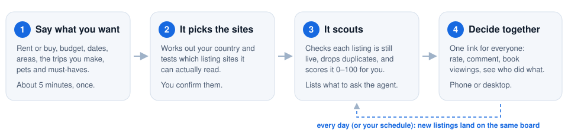
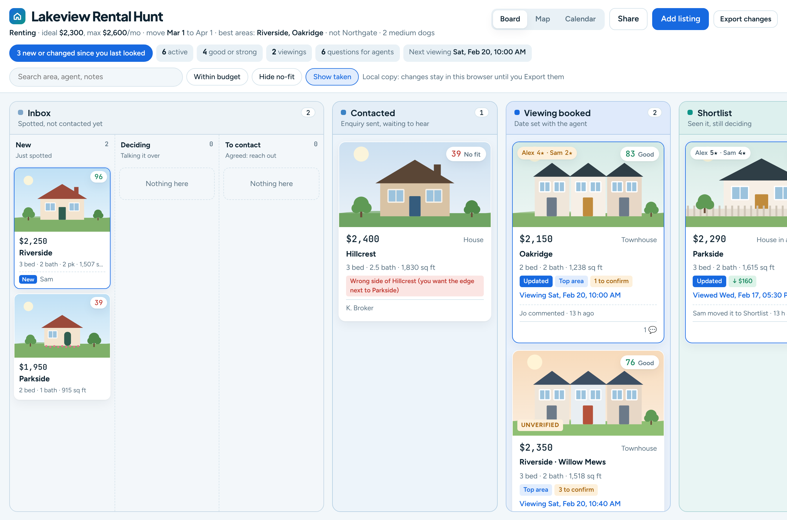
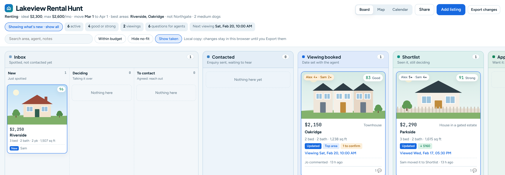
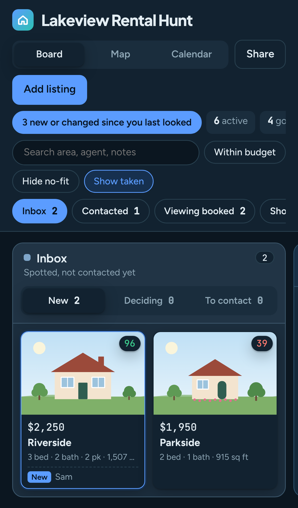
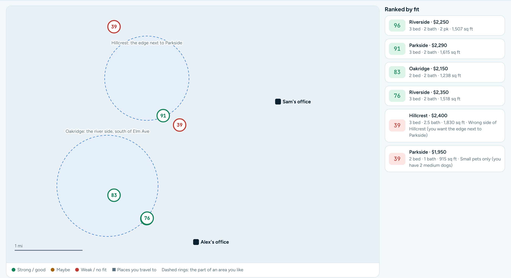
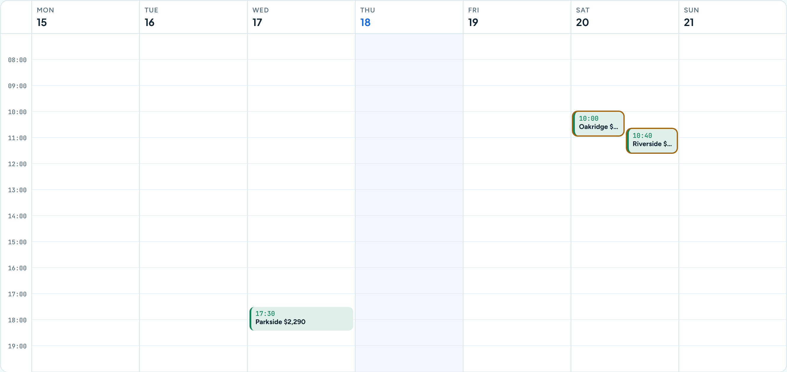

# Hermit

**Scouts every shell before you move in.**

A Claude skill that runs your home search, renting or buying, in any country. Tell it once what you're looking for. It checks the listing sites on a schedule, keeps only listings that are real and still available, scores each one against *your* priorities, tells you what to ask the agent, and puts it all on **one board your whole household shares**.

(Hermit crabs inspect every shell before they move in. So does this.)





## One link for the whole household

Finding a home is a group decision, and the usual way of making it is a chat full of forwarded links. Hermit replaces that with one board everyone works from.

- **Bookmark it once.** Every scout adds to the same board, and the link never changes. Nobody forwards a listing again.
- **Everyone is themselves.** Each person picks their name once, so stars, comments and moves carry it: "Alex 4★ · Sam 2★".
- **See what changed since you last looked.** Cards someone else (or the scout) added, moved, rated or commented on get a tag and a line like "Sam moved it to Shortlist · 2 h ago". One tap shows only those.
- **Helpers welcome.** A parent or a friend who knows the area can comment and move cards without their stars counting.
- **Inviting takes a minute.** Share → add their email → Can edit. The board's **Share** button walks them through it and shows who has joined.



The shared board is a private Claude artifact, so it needs claude.ai or Claude Desktop. In Claude Code alone, the board runs on your computer and others get a read-only copy.

## Get started

**1. Install** (pick one)

| Where | How |
|---|---|
| Claude Code (plugin) | `/plugin marketplace add mblignault/hermit` then `/plugin install hermit@hermit` |
| Claude Code or Desktop (plain skill) | Copy `skills/hermit` into `~/.claude/skills/` |
| claude.ai | Zip the `skills/hermit` folder (the zip should contain `hermit/SKILL.md`) and upload it under Customize → Skills. Turn on code execution. |

**2. Say** "help me find a place to live". That's it. Setup takes about 5 minutes:

1. **Basics:** rent or buy, where, budget, when you need to move, who's moving and any pets.
2. **What matters:** places you travel to often, areas you like or would never live in, must-haves and deal-breakers in your own words.
3. **Sites:** it suggests the main listing sites for your country, tests which ones it can actually read, and shows you the result.
4. **Schedule and board:** how often to check (daily is usual for rentals), then it runs the first scout and builds your board.

Every question has a default, and you can say "skip" at any point. You can tune it later with `settings`.

**3. After setup,** new listings that pass your deal-breakers land in the board's **Inbox** on schedule, and you get a short summary like this:

> **3 new on the board** · [Board]
> - **$2,250 · Riverside · 96 (strong):** 3 bed, 1 mi from Alex's office, park 0.4 mi away. Under budget, so call first.
> - **$2,150 · Oakridge · 83 (good):** 2 bed townhouse in a top area. Ask: are 2 medium dogs OK?
> - **$2,350 · Riverside · 76 (good):** townhouse, no patio mentioned. Ask: is there an outdoor area?
> - Skipped: a great-looking place in Parkside that only allows small pets.

Quiet days get one line ("Scout ran, nothing new: 3 sites, 7 areas, 42 checked"), so you always know it ran. The board shows when the last scout ran, too.

## Where it works

| | Scouting | Schedule | Board |
|---|---|---|---|
| **Claude Code** on your computer | ✓ | Routines, or a cron line it writes for you | Live board on your computer (`hermit.js serve`) |
| **claude.ai** with code execution | ✓ | Scheduled tasks, where available | **Shared** board your household can edit, as a private Claude artifact |
| **Claude Desktop / Cowork** | ✓ | Scheduled tasks, where available | Shared artifact board or local board |
| Chat with no tools | ✗ | | |

It needs Node 18+ for its helper script (no dependencies), and web access to read listing sites. Without a scheduler, just say "scout" whenever you like.

## What you can say

You can type these after the skill's command (`/hermit scout` as a plain skill, `/hermit:hermit scout` as a plugin) or just ask in plain words.

| Everyday | |
|---|---|
| `scout` | Check the sites now |
| `add` + a link | Score one listing and put it on the board (a pasted description or screenshot works too) |
| `questions` | Everything to ask agents, grouped by listing, ready to paste |
| `board` | Open or rebuild the board |
| `status` | Quick summary, including the last scout |

| Tuning and admin | |
|---|---|
| `settings` | Change budget, dates, areas, must-haves. `settings calibrate` tunes the scoring from places you've starred |
| `sources` | The sites it checks and how; `sources test` re-checks them |
| `schedule` | `schedule daily 07:00`, `schedule weekdays 07:00`, `schedule off` |
| `verify` | Re-check that everything on the board is still available |
| `export` · `reset` · `help` | Your data as JSON or CSV · start over (backed up first) · short help |

## The board

| Card detail | On a phone |
|---|---|
|  |  |

- **Columns:** Inbox (New, Deciding, To contact), Contacted, Viewing booked, Shortlist, Apply (Offer when buying) and No. Drag cards between them.
- **Cards:** the fit score, deal-breakers in red, how many facts are still to confirm, price drops, each person's own star rating after a viewing (amber when you disagree), and who changed it last.
- **Card detail:** why it scored what it did, with unknowns striped; what to ask the agent; and every fact, editable. Fix a fact and the score updates on the spot.
- **One card per home:** the same place cross-posted by several agencies is linked, not repeated.
- **Last scout** in the header shows the scout is alive. Each card's detail keeps its recent activity.
- **Phone:** one column per swipe, light and dark themes.

**Map:** your listings, the places you travel to, and the part of an area you like (dashed). No map service needed.



**Calendar:** the week's viewings. Ones less than 45 minutes apart are flagged.



Try it with fictional data: `node skills/hermit/scripts/hermit.js demo` (it serves a temporary copy, so nothing in the repo changes). The demo pictures are illustrations; real hunts show each listing's own photo.

## How scoring works

Each listing gets 0–100 from your own priorities: location (your areas and your real trips), price, pets, outdoor space, entertaining, layout, property type, what's within walking distance, timing and features.

- **Deal-breakers win.** No pets for your two dogs, the wrong side of an area you only half-like, over budget: any one makes a listing "no fit", however nice the kitchen.
- **Unknown isn't no.** Most listings don't say whether pets are allowed. Unknowns score in the middle and become questions for the agent. Answer one and the score updates.
- **Location means your trips**, not suburb names. It works out where each listing actually is, and fixes ones a site files under the wrong area.
- **Calibrated to your gut.** Star two places you like and one you don't, and `settings calibrate` adjusts the scoring until the order matches.
- 85+ strong · 72+ good · 58+ maybe.

## Why it's built this way

It comes from a real two-person rental hunt, and each rule fixes something that went wrong:

- **Verified, not scraped.** A listing reaches the board only after its own page loads and looks live. Search results are full of places already let (6 of 9 in one early batch).
- **An error isn't "taken".** Sites often refuse automated visitors while the listing is fine, so errors are retried, not treated as gone.
- **Scores are never stored.** They're worked out live from the facts and your current settings, so they can't go stale.
- **Don't trust one input.** Email alerts miss listings, so the scout checks the sites directly.

## Countries

Packs for 🇿🇦 ZA · 🇬🇧 GB · 🇺🇸 US · 🇨🇦 CA · 🇦🇺 AU · 🇳🇿 NZ · 🇮🇪 IE · 🇩🇪 DE · 🇳🇱 NL · 🇫🇷 FR · 🇪🇸 ES · 🇵🇹 PT · 🇮🇹 IT · 🇦🇪 AE · 🇮🇳 IN · 🇸🇬 SG list the main portals, currency, units, how rent is quoted (weekly in AU and NZ), affordability rules of thumb and local terms ("let agreed", "SSTC", "Kaltmiete").

Only South Africa has been used on a real hunt so far. For the others, setup tests every site live before relying on it. PRs with tested search URLs are welcome.

## Privacy

- **Local board:** your hunt stays in a folder on your computer that tells git to ignore it.
- **Shared board:** your data lives in a private Claude artifact. Only people you share it with can see it, and they see all of it, including your budget (and, when buying, your income).
- This repo contains only fictional examples. `tools/privacy-scan.js` blocks commits containing emails, phone numbers, ID numbers, real listing links, or any term from your personal word list (kept outside the repo, in `~/.config/hermit/privacy-denylist`). CI runs it on every push.

## Respecting sites

The scout reads at a human pace, within a per-run limit, and never gets around captchas, logins or bot walls. A site it can't read becomes "use your browser", "forward the email alerts" or "paste it in".

## Develop

```
npm test        # scorer and CLI tests
npm run check   # privacy scan + tests
npm run demo    # the demo board
```

MIT licence.
