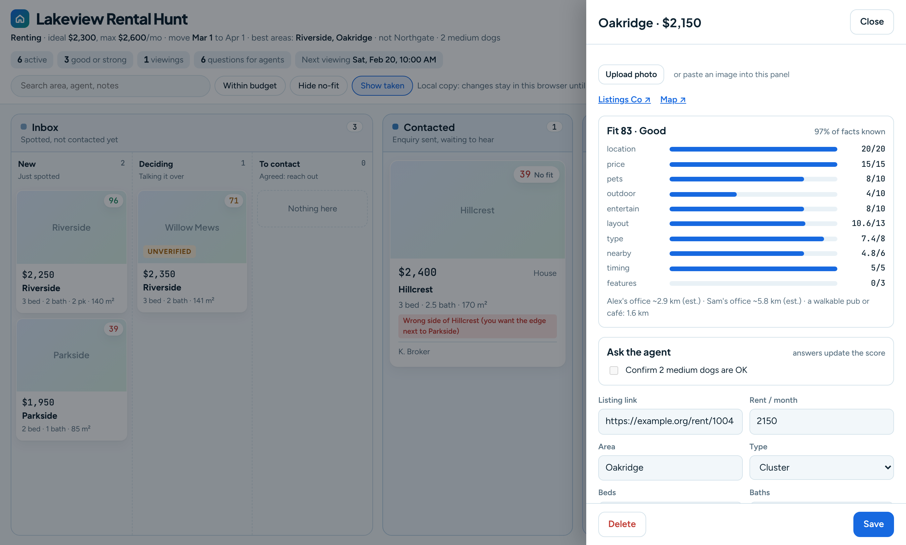

# Home Hunt

A Claude skill that runs your home search, renting or buying, in any country.

It interviews you once to learn what you actually want. It tests which listing sites it can read where you live, then scouts them on a schedule. It only brings back listings that are real and still available, each scored against your own priorities, and keeps them on a shared board you and your household can work from.


## Why it's built this way

Everything here comes from a real two-person rental hunt and the mistakes it made:

- **Verified, not scraped.** A listing reaches your board only after its own page has loaded live. Search results are full of stock that's already let, and an error page means "unverified", not "taken".
- **Your scoring, calibrated.** You rank what matters, then show it two places you love and one you'd never take. It tunes the weights until the scores match your gut.
- **Deal-breakers are deal-breakers.** No pets for your two medium dogs, the wrong side of a suburb you only half-like, over budget: any one of these makes a listing "no fit", however nice the kitchen.
- **Unknowns become questions.** Most listings don't say whether pets are allowed or whether there's a garden. Those facts score in the middle, and each one becomes an "ask the agent" item. Fill in the answer and the score updates.
- **Location means your trips.** It geocodes listings and the places you actually travel to, and fixes listings that portals file under the wrong suburb.
- **One card per home.** The same unit gets cross-posted by several agencies with slightly different details. It links these instead of cluttering your board.
- **Scores are never stored.** They're computed live from facts and your current settings, so they can't go stale.

## Install

**Claude Code plugin**

```
/plugin marketplace add mblignault/home-hunt
/plugin install home-hunt@home-hunt
```

**As a plain skill** (Claude Code or the Claude desktop app): copy `skills/home-hunt` into `~/.claude/skills/`, or zip that folder and upload it under Settings → Capabilities → Skills on claude.ai.

You'll need Node 18+ for the helper script. It has no dependencies.

## Use

Say "help me find a place to live", or:

| | |
|---|---|
| `/home-hunt setup` | First-run interview: rent or buy, budget, dates, areas, the places you travel to, must-haves, weights, calibration, sites, scout schedule and board |
| `/home-hunt scout` | Check the sites now |
| `/home-hunt add <link>` | Score and track one listing (a pasted description or a screenshot works too) |
| `/home-hunt asks` | Every question to put to agents, grouped by listing |
| `/home-hunt verify` | Re-check that every active listing is still on the market |
| `/home-hunt settings` · `sources` · `schedule` · `status` · `board` · `export` · `reset` · `help` | |

## The board



- **Lanes:** Inbox (New, Deciding, To contact), then Contacted, Viewing booked, Shortlist, Apply (Offer when buying) and No.
- **Cards:** photo, live fit score, each person's star ratings (highlighted when you disagree), deal-breakers, open questions, price drops and cross-post count.
- **Card detail:** score breakdown, what to ask the agent, editable facts, likely duplicates, comments and history.
- **Map:** listings, your anchors and partial-area zones, with no map tiles needed. **Calendar:** your week of viewings, with back-to-back slots marked.
- **Devices:** works on a phone, with light and dark themes.

There are three ways to run it:
- **Shared live board:** a Claude artifact backed by a database. This is the one for households on claude.ai.
- **Local live board:** `node skills/home-hunt/scripts/hh.js serve`.
- **Read-only snapshot:** a single HTML file.

Try the demo with fictional data:

```
node skills/home-hunt/scripts/hh.js --dir examples/demo serve
```

## Countries

Packs for ZA, GB, US, CA, AU, NZ, IE, DE, NL, FR, ES, PT, IT, AE, IN and SG cover portals, currency, units, rent period (weekly in AU and NZ, yearly in the UAE), affordability rules of thumb, buying costs to look up, and local vocabulary ("let agreed", "SSTC", "Kaltmiete", "braai"). Setup tests every site live, so a pack never claims a site works without checking.

South Africa is field-tested. The other packs need a real hunt, and PRs with tested search URLs are welcome.

## Privacy

Your hunt stays in your workspace folder, which ignores itself in git. This repo contains only fictional examples. `tools/privacy-scan.js` blocks commits containing emails, phone numbers, ID numbers, real listing URLs, or any term in your local `.privacy-denylist`. CI runs it on every push.

## Respecting sites

The scout reads at a human pace, within a per-run budget, and never bypasses captchas, logins or bot walls. A site that can't be read becomes "use your browser", "email alerts" or "paste it in".

## Develop

```
npm test        # scorer and CLI tests
npm run check   # privacy scan + tests
```

MIT licence.
